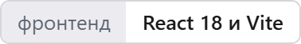
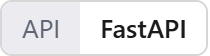
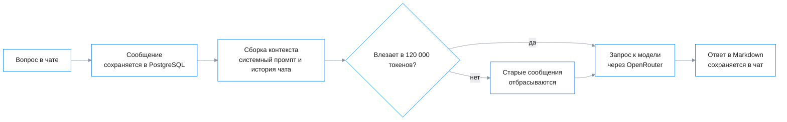

<p align="center">
  <picture>
    <source media="(prefers-color-scheme: dark)" srcset="docs/readme/banner.dark.png">
    
  </picture>
</p>

<p align="center">
  Владелец малого бизнеса пишет вопрос в чат и получает короткий ответ по-русски: черновик договора,
  разбор платежей, идеи для продвижения или план задач для сотрудников.
</p>

<p align="center">
  <!-- readme:buttons -->
  <a href="#запуск"><picture><source media="(prefers-color-scheme: dark)" srcset="docs/readme/cta-run.dark.png"></picture></a>
  <a href="#как-это-работает"><picture><source media="(prefers-color-scheme: dark)" srcset="docs/readme/cta-how.dark.png"></picture></a>
  <!-- /readme:buttons -->
</p>

<p align="center">
  <!-- readme:status -->
  <a href="#зачем-это"><picture><source media="(prefers-color-scheme: dark)" srcset="docs/readme/badge-status-1.dark.png"></picture></a>
  <a href="#как-это-работает"><picture><source media="(prefers-color-scheme: dark)" srcset="docs/readme/badge-status-2.dark.png"></picture></a>
  <br>
  <picture><source media="(prefers-color-scheme: dark)" srcset="docs/readme/badge-status-3.dark.png"></picture>
  <picture><source media="(prefers-color-scheme: dark)" srcset="docs/readme/badge-status-4.dark.png"></picture>
  <a href="LICENSE"><picture><source media="(prefers-color-scheme: dark)" srcset="docs/readme/badge-status-5.dark.png"></picture></a>
  <!-- /readme:status -->
</p>

<p align="center">
  <!-- readme:stack -->
  <picture><source media="(prefers-color-scheme: dark)" srcset="docs/readme/badge-stack-1.dark.png"></picture>
  <picture><source media="(prefers-color-scheme: dark)" srcset="docs/readme/badge-stack-2.dark.png"></picture>
  <picture><source media="(prefers-color-scheme: dark)" srcset="docs/readme/badge-stack-3.dark.png"></picture>
  <br>
  <picture><source media="(prefers-color-scheme: dark)" srcset="docs/readme/badge-stack-4.dark.png"></picture>
  <picture><source media="(prefers-color-scheme: dark)" srcset="docs/readme/badge-stack-5.dark.png"></picture>
  <!-- /readme:stack -->
</p>

<p align="center">
  <!-- readme:nav -->
  <a href="#зачем-это"><picture><source media="(prefers-color-scheme: dark)" srcset="docs/readme/badge-nav-1.dark.png"></picture></a>
  <a href="#как-это-работает"><picture><source media="(prefers-color-scheme: dark)" srcset="docs/readme/badge-nav-2.dark.png"></picture></a>
  <a href="#попробовать-за-две-минуты"><picture><source media="(prefers-color-scheme: dark)" srcset="docs/readme/badge-nav-3.dark.png"></picture></a>
  <br>
  <a href="#запуск"><picture><source media="(prefers-color-scheme: dark)" srcset="docs/readme/badge-nav-4.dark.png"></picture></a>
  <a href="#устройство"><picture><source media="(prefers-color-scheme: dark)" srcset="docs/readme/badge-nav-5.dark.png"></picture></a>
  <a href="#ограничения"><picture><source media="(prefers-color-scheme: dark)" srcset="docs/readme/badge-nav-6.dark.png"></picture></a>
  <a href="#команда"><picture><source media="(prefers-color-scheme: dark)" srcset="docs/readme/badge-nav-7.dark.png"></picture></a>
  <!-- /readme:nav -->
</p>

> **Помощник помнит весь чат, пока он помещается в 120 000 токенов.** Перед каждым запросом к модели
> история собирается с конца и обрезается со старых сообщений, поэтому запрос никогда не выходит за
> лимит контекста, а последние реплики не теряются. Логика — в `src/backend/features/llm/context_builder.py`.

## Зачем это

Владелец малого бизнеса сам себе юрист, бухгалтер, маркетолог и операционный директор, и на каждую
роль уходят часы. Помощник закрывает типовые вопросы в одном окне: **суммирует переписку и встречи,
составляет и правит документы, предлагает шаблоны и идеи для маркетинга, разбирает продажи, остатки
и платежи и подсказывает следующий шаг**.

Ответы строятся только на том, что пользователь написал сам. Запросы не по роли помощник вежливо
отклоняет и объясняет причину, все ответы и отказы — на русском.

## Как это работает



<table>
<tr>
<td valign="top" width="33%">

**1. У каждого разговора своя история**

Пользователь создаёт сколько угодно чатов, переименовывает и удаляет их. Сообщения хранятся в базе,
поэтому к разговору можно вернуться после перезагрузки.

<sub>Модули `chats` и `messages` в `src/backend/features`</sub>

</td>
<td valign="top" width="33%">

**2. Роль задана жёстко**

Системный промпт перечисляет шесть видов задач и запрещает выполнять остальные. На запрос вне роли
модель отвечает вежливым отказом с причиной.

<sub>Промпт в `src/backend/features/llm/system_prompt.py`</sub>

</td>
<td valign="top" width="33%">

**3. Вход без токена в браузерном хранилище**

Токен доступа подписан RS256 и лежит в cookie, а не в `localStorage`. Сервер берёт пользователя из
cookie на каждом запросе к чатам и сообщениям.

<sub>`get_current_user_from_cookie` в модуле `users`</sub>

</td>
</tr>
</table>

## Попробовать за две минуты

После [запуска](#запуск) откройте http://localhost.

| | Что сделать | Что увидите |
|---|---|---|
| 1 | Зарегистрироваться и войти | Открывается чат, слева список разговоров |
| 2 | Спросить: «Составь шаблон договора оказания услуг для ИП» | Черновик договора с разметкой: заголовки, списки, поля для заполнения |
| 3 | Спросить о чём-то вне бизнеса, например попросить написать стихи | Вежливый отказ на русском с объяснением, почему это не по роли |

## Запуск

Нужны Docker с Docker Compose и ключ [OpenRouter](https://openrouter.ai). Модель по умолчанию
`openai/gpt-oss-20b:free` бесплатная, но запросы к ней требуют ключа.

```bash
cd src/backend
cp .env.example .env
cp .env.app_config.example .env.app_config
docker compose --env-file .env up -d --build
```

В `.env.app_config` впишите ключ в `APP_CONFIG__LLM__API_KEY`. Интерфейс — http://localhost,
документация API в Swagger — http://localhost:8000/docs.

<details>
<summary><b>Переменные окружения</b></summary>
<br>

| Файл | Переменная | Назначение |
|---|---|---|
| `.env` | `POSTGRES_DB`, `POSTGRES_USER`, `POSTGRES_PASSWORD`, `POSTGRES_PORT` | База PostgreSQL в контейнере |
| `.env` | `DB_URL` | Строка подключения бэкенда, `postgresql+asyncpg://…` |
| `.env.app_config` | `APP_CONFIG__RUN__HOST`, `APP_CONFIG__RUN__PORT` | Где слушает бэкенд |
| `.env.app_config` | `APP_CONFIG__LLM__API_KEY` | Ключ OpenRouter, обязателен |
| `.env.app_config` | `APP_CONFIG__LLM__API_BASE` | Адрес провайдера, по умолчанию OpenRouter |
| `.env.app_config` | `APP_CONFIG__LLM__DEFAULT_MODEL` | Модель, по умолчанию `openai/gpt-oss-20b:free` |

</details>

## Устройство

Фронтенд на React отдаёт nginx, бэкенд на FastAPI разложен по модулям `users`, `chats`, `messages`
и `llm`, данные лежат в PostgreSQL с миграциями Alembic. Ключевое решение принимает `llm`: собирает
контекст в пределах лимита и отправляет его модели.

| Метод | Путь | Назначение |
|---|---|---|
| `POST` | `/api/v1/users/signup` | Регистрация |
| `POST` | `/api/v1/users/login` | Вход, ставит cookie с токеном |
| `GET` | `/api/v1/users/me` | Текущий пользователь |
| `POST` | `/api/v1/chats/` | Новый чат |
| `GET` | `/api/v1/chats/{chat_id}/` | Чат с сообщениями |
| `PATCH` | `/api/v1/chats/{chat_id}/` | Переименование чата |
| `DELETE` | `/api/v1/chats/{chat_id}/` | Удаление чата |
| `POST` | `/api/v1/messages/send` | Сообщение пользователя и ответ модели |

Полная схема запросов и ответов — в Swagger на запущенном стенде.

## Ограничения

- **Без ключа OpenRouter помощник не отвечает.** Локальной модели и запасного ответа нет, чат и
  история работают, а ответы — нет.
- **Ключи подписи JWT лежат в репозитории.** `jwt-private.pem` и `jwt-public.pem` в `src/backend`
  годятся только для демо, на любом внешнем стенде их нужно сгенерировать заново.
- **Автотестов нет.** `pytest` подключён в зависимостях, но тестов в репозитории пока нет, качество
  ответов модели не измерялось.

## Команда

| Участник | Зона ответственности |
|---|---|
| [Михаил Хорохорин](https://github.com/mikhailkhorokhorin) | Бэкенд, интеграция с моделью, база данных |
| Артём Савельев | Бэкенд, регистрация и авторизация |
| Роберт Савицкас | Фронтенд, UI/UX |
| Тимофей Пупыкин | Тестирование, Docker и CI/CD, стабильность и развёртывание |

<p align="center">
  <picture><source media="(prefers-color-scheme: dark)" srcset="docs/readme/mark.dark.png"></picture>
  <br>
  <sub>Команда Ullax, хакатон AlfaFuture, 2025. Лицензия <a href="LICENSE">GPL-3.0</a>.</sub>
</p>
